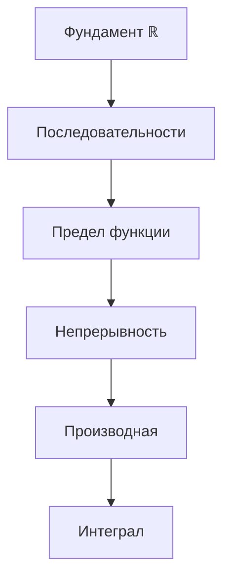

# 🗺️ Roadmap: Математический анализ (2 года)

## 📊 Теоретическое дерево зависимостей

## 📋 Порядок изучения

### Фундамент
- [ ] [[Действительные числа как упорядоченное поле]]
- [x] [[Полнота действительных чисел]]
- [x] [[Точная верхняя грань (sup)]]
- [ ] [[Точная нижняя грань (inf)]]
- [ ] [[Следствия полноты]]

### Дальше
- [ ] [[Последовательности]]
- [ ] [[Предел функции]]
- [ ] [[Непрерывность]]
- [ ] [[Производная]]
- [ ] [[Интеграл]]

## Проработано

- [[Полнота действительных чисел]]
- [[Точная верхняя грань (sup)]]
