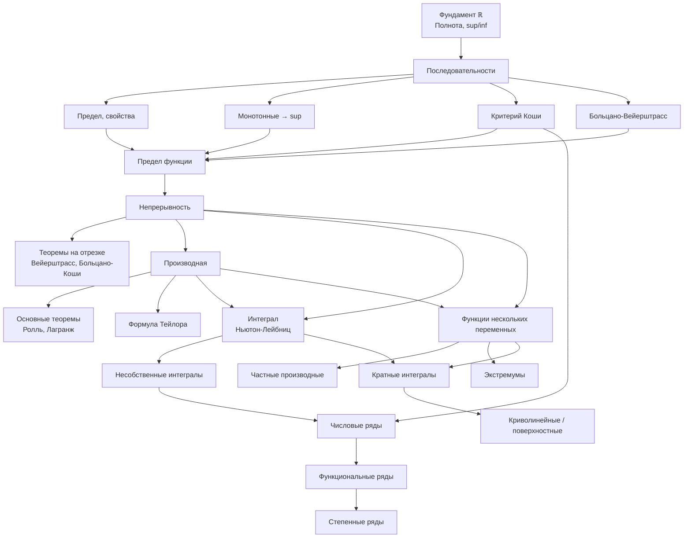

# 🗺️ Roadmap: Математический анализ (2 года)

Сохраняем только проработанное. Остальное — фантомный скелет.

## 📊 Теоретическое дерево зависимостей

## 📋 Порядок изучения (шаговый)

### Год 1 — Анализ I
- [x] [[Полнота действительных чисел]]
- [x] [[Точная верхняя грань (sup)]]
- [ ] [[Точная нижняя грань (inf)]]
- [ ] Последовательности (предел, монотонные, Коши, Больцано-Вейерштрасс)
- [ ] Предел функции
- [ ] Непрерывность + теоремы на отрезке
- [ ] Производная + Тейлор
- [ ] Интеграл

### Год 2 — Анализ II
- [ ] Несобственные интегралы + числовые ряды
- [ ] Функциональные и степенные ряды
- [ ] Функции нескольких переменных
- [ ] Кратные и криволинейные интегралы

## 🛠️ Техника (отдельные справочники)

- Замечательные пределы и эквивалентности
- Правило Лопиталя
- Таблица интегралов и методы
- Признаки сходимости рядов

## Проработано

Пока только фундамент:
- [[Полнота действительных чисел]]
- [[Точная верхняя грань (sup)]]

Дальше наполняем по мере прохождения.
