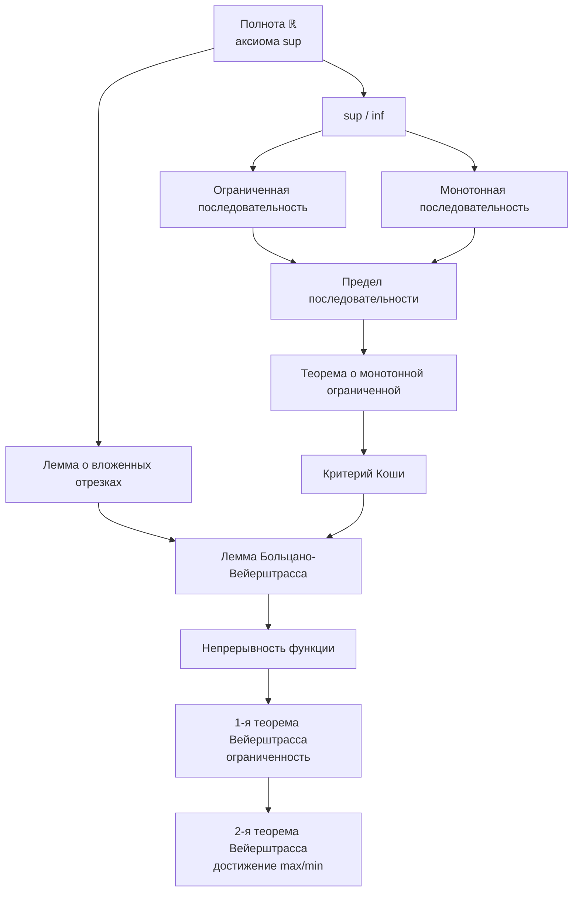

# 🗺️ Phantom Roadmap: Матанализ (до теорем Вейерштрасса)

Это **фантомный скелет** — карта всей картины от основ до сегодняшних тем.  
Заметки пока пустые (или с минимумом). Мы будем наполнять их вместе.

## 📊 Визуальная схема зависимостей

## 📋 Фантомный список тем (чеклист)

### Блок 1. Основы (до последовательностей)
- [ ] [[Полнота действительных чисел]]
- [ ] [[Точная верхняя грань (sup)]]
- [ ] [[Точная нижняя грань (inf)]]

### Блок 2. Последовательности → Критерий Коши
- [ ] [[Ограниченная последовательность]]
- [ ] [[Монотонная последовательность]]
- [ ] [[Предел последовательности]]
- [ ] [[Сходящаяся последовательность]]
- [ ] [[Теорема о сходимости монотонной ограниченной последовательности]]
- [ ] [[Критерий Коши]]

### Блок 3. Дальше (сегодняшние темы)
- [ ] [[Лемма о вложенных отрезках]]
- [ ] [[Лемма Больцано-Вейерштрасса]]
- [ ] [[Непрерывность функции]]
- [ ] [[Первая теорема Вейерштрасса (ограниченность)]]
- [ ] [[Вторая теорема Вейерштрасса (достижение max/min)]]

## Как пользоваться
1. Открой эту заметку — увидишь схему и чеклист.
2. Кликай по `[[ссылкам]]` — они ведут к пустым заметкам-заготовкам.
3. В Graph View увидишь связи.
4. Пиши мне: «Давай разберём [тему]» — и я буду дописывать содержание, примеры, связи.

> Это живой скелет. Мы будем его расти вместе.
