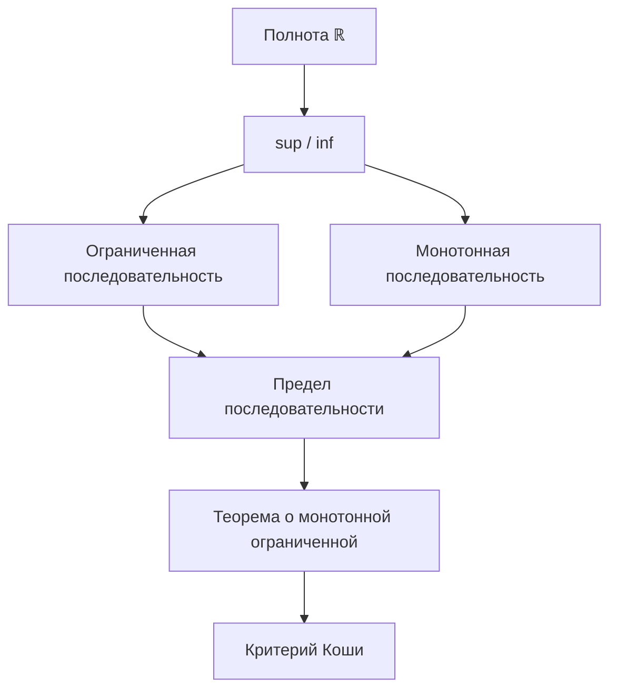

# 🗺️ Roadmap: Матанализ

## 📊 Схема зависимостей

## Чеклист

- [x] [[Полнота действительных чисел]]
- [x] [[Точная верхняя грань (sup)]]
- [ ] [[Точная нижняя грань (inf)]]
- [ ] [[Ограниченная последовательность]]
- [ ] [[Монотонная последовательность]]
- [ ] [[Предел последовательности]]
- [ ] [[Критерий Коши]]

Фундамент готов. Дальше — последовательности.
